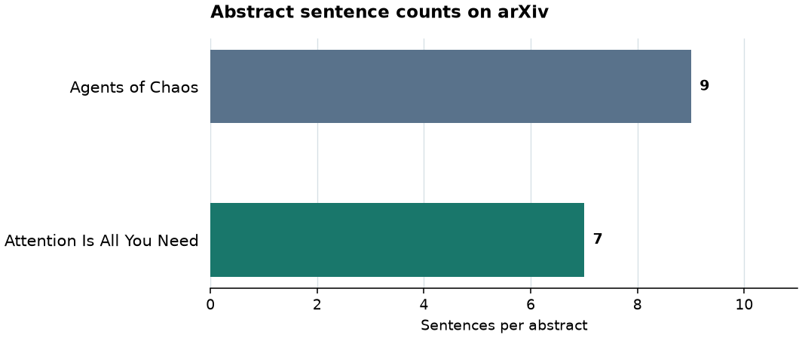

# Comparing arXiv abstracts

[](https://github.com/jrwebb7/nlp-05-web-documents-custom/actions/workflows/ci-python-zensical.yml)
[](https://jrwebb7.github.io/nlp-05-web-documents-custom/)

**Author** `jrwebb7` · 2026-11

This project uses an Extract, Validate, Transform, Load (EVTL) pipeline to collect
bibliographic metadata from arXiv HTML. I added an abstract sentence count and
applied the pipeline to *Attention Is All You Need*. Its abstract averaged
23.7 words per sentence. The original *Agents of Chaos* example averaged 19.7.



## Run the project

Install [Git](https://git-scm.com/downloads) and [uv](https://docs.astral.sh/uv/getting-started/installation/).
From a terminal, clone this repository and sync the locked Python 3.14 environment.

```bash
git clone https://github.com/jrwebb7/nlp-05-web-documents-custom.git
cd nlp-05-web-documents-custom
uv sync --locked
```

Run these commands from the repository root. The first command runs the original
example. The remaining commands repeat the sentence-count experiment on the original
paper, process the selected paper, and generate the comparison CSV and chart.

```bash
uv run python -m nlp.pipeline_web_html
uv run python -m nlp.pipeline_web_html_custom --experiment
uv run python -m nlp.pipeline_web_html_custom
uv run python -m nlp.plot_abstract_comparison
```

## Outputs

| Output | Location |
| --- | --- |
| Original example HTML and CSV | `data/raw/case_raw.html`, `data/processed/case_processed.csv` |
| Custom runs' raw HTML | `data/generated/raw/` |
| Custom runs' full CSVs | `data/generated/processed/` |
| Comparison metrics | [abstract-comparison.csv](docs/data/abstract-comparison.csv) |
| Sentence-count chart | [abstract-sentence-counts.png](docs/images/abstract-sentence-counts.png) |

The experiment and custom runs use separate filenames for each paper. The
[published report](https://jrwebb7.github.io/nlp-05-web-documents-custom/)
explains the HTML validation, the experiment, and the interpretation.

## Verify changes

```bash
uvx prek run --all-files
uv run ty check
uv run python -m pytest
uv run python -m zensical build
```

## Links

- [Published project report](https://jrwebb7.github.io/nlp-05-web-documents-custom/)
- [Denise Case's original project](https://github.com/denisecase/nlp-05-web-documents)
- [Selected arXiv abstract](https://arxiv.org/abs/1706.03762)
- [Professional Python Workflow Guide](https://denisecase.github.io/pro-analytics-02/)

I used AI assistance to implement and verify the planned experiment and to draft
the documentation. [AI use notice](AI_USE.md)
