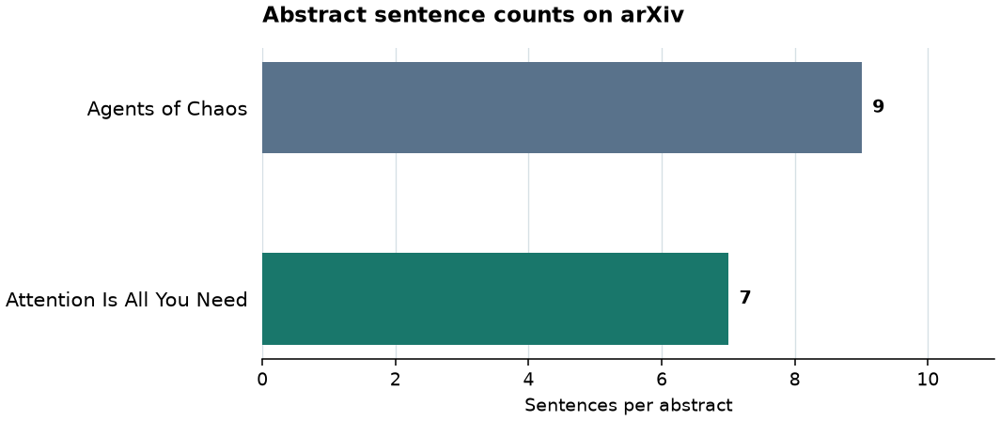

# Comparing two arXiv abstracts

**Author** `jrwebb7` · 2026-11

Can the course pipeline extract metadata from a different arXiv abstract page?
How does the selected paper's abstract compare with the example in words and
sentences?

## Data

I used the public arXiv abstract pages for *Agents of Chaos* (2602.20021)
and *Attention Is All You Need* (1706.03762), retrieved in November 2026.
The first paper is the original example. The second is the selected source
for the custom application. [Example source](https://arxiv.org/abs/2602.20021)
[Selected source](https://arxiv.org/abs/1706.03762)

## Techniques and verification

1. **Extract.** Requests retrieves each HTML page and saves the response locally.
2. **Validate.** BeautifulSoup checks for the required elements. The selectors
   `h1.title`, `div.authors`, and `blockquote.abstract` identify the paper's
   title, individual author links, and abstract. The pipeline also checks
   `div.subheader` and `div.dateline` for subject and submission information.
3. **Transform.** The example transform cleans the text, builds author names
   from their links, and reads the arXiv ID from the canonical URL. pandas
   creates one row per run. The custom transform adds
   `abstract_sentence_count` to the existing metadata, author count, and
   whitespace-based word count.
4. **Load.** pandas writes the row to a CSV. Matplotlib builds the chart from
   the two saved CSVs.

I ran the original pipeline with `uv run python -m nlp.pipeline_web_html`.
It validated the *Agents of Chaos* page and saved the raw HTML and a CSV with
one row and eight columns. The output reported 38 authors and 177 abstract
words. [Original example HTML](https://github.com/jrwebb7/nlp-05-web-documents-custom/blob/main/data/raw/case_raw.html)
[Original example CSV](https://github.com/jrwebb7/nlp-05-web-documents-custom/blob/main/data/processed/case_processed.csv)

## Sentence-count experiment

I predicted that adding a sentence count would produce one extra integer column
while preserving the original eight fields. The change uses text the pipeline
already extracts, so I could test it on the same paper.

The custom transform splits the cleaned abstract after a period, question mark,
or exclamation point followed by whitespace. It counts the resulting text spans.
A decimal point within a number stays inside its span. Blank or `unknown` text
counts as zero.

I ran the experiment with `uv run python -m nlp.pipeline_web_html_custom --experiment`.
The saved CSV contained one row and nine columns. All eight original fields
matched the baseline CSV, and the new `abstract_sentence_count` was **9**.

## Custom application

The custom configuration points to *Attention Is All You Need* and uses separate
output filenames. I ran `uv run python -m nlp.pipeline_web_html_custom`, confirmed
that all five required HTML elements were present, and checked that the CSV
contained the expected arXiv ID, title, subject, and eight authors.

The full HTML and CSV are saved locally under `data/generated/raw/` and
`data/generated/processed/`. The [comparison CSV](data/abstract-comparison.csv)
contains the reported metrics. [Run instructions](https://github.com/jrwebb7/nlp-05-web-documents-custom#run-the-project)

## Results

| Paper | Authors | Abstract words | Abstract sentences | Words per sentence |
| --- | ---: | ---: | ---: | ---: |
| Agents of Chaos | 38 | 177 | 9 | 19.7 |
| Attention Is All You Need | 8 | 166 | 7 | 23.7 |

Words per sentence is the abstract word count divided by the sentence count,
rounded to one decimal place.

## Interpretation

The two abstracts differed by 11 words and two sentences. The *Attention Is All
You Need* abstract averaged about four more words per sentence. The sentence
count adds information about how the text is organized even when word totals
are close.

## Limitations and next steps

This comparison uses two papers. A broader sample across arXiv categories would
help show how much sentence length varies. The punctuation rule can split some
abbreviations incorrectly, and the HTML selectors depend on arXiv's page
structure. I would hand-check a sample of sentence boundaries and compare the
results with a sentence tokenizer before using the metric on a larger dataset.

## Project links

- [Custom GitHub repository](https://github.com/jrwebb7/nlp-05-web-documents-custom)
- [Course example](https://github.com/denisecase/nlp-05-web-documents)
- [Project instructions](project-instructions.md)
- [Glossary](glossary.md)
- [Professional Python Workflow Guide](https://denisecase.github.io/pro-analytics-02/)
